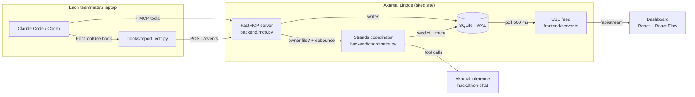
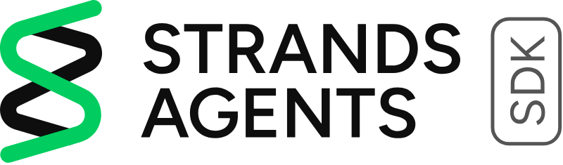
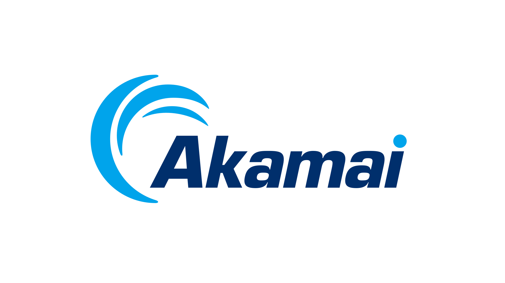

<p align="center">
  
</p>

<p align="center">
  <b>Live dashboard:</b> <a href="https://skeg.site">skeg.site</a>
  &nbsp;·&nbsp; <b>Health:</b> <a href="https://skeg.site/health">skeg.site/health</a>
  &nbsp;·&nbsp; <b>MCP:</b> <code>https://skeg.site/mcp</code>
</p>

# Skeg: Hack Midwest 2026

*The Captains⚓: Aruneem Bhowmick, Matthew Moisseyev, Ogochukwu Ibe-Ikechi, and Sandarika Warjri*

**Skeg is a live coordination dashboard for development teams using multiple coding agents, making shared API contracts, conflicting changes, and affected teammates visible before integration breaks.**

## The problem

Shipping fast can get messy; one teammate's agent can change an API response shape, while another teammate's agent builds a frontend against the old shape. Nobody finds out until merge. Plenty of frameworks exist to coordinate one person's agents, but nothing exists to coordinate a whole team's set of agents. Where edits are fast, time is money, and several agents each hold different context, the importance is clear.

Skeg catches drift and collisions in coding agents in just a few seconds after the edit, while the other agent is still typing, and can name the teammate it breaks, suggest a fix, and hand the alert to that teammate's agent on its very next tool call. Simply put, Skeg gives a team's coding agents a single shared record of what the team agreed on, and places a feedback loop that catches any edit violating that agreement within seconds, putting the correction directly into the affected agent's context long before anyone would have found any vulnerabilities at merge.

## How it works



A `PostToolUse` hook reports every edit to the FastMCP server's `/events` route, whether or not the agent chooses to call a tool. If the edited file owns a contract in the shared SQLite spec, the Strands coordinator, running on Akamai's `hackathon-chat`, judges the diff against the **agreed shape** (not the old code), and either raises an alert naming the affected teammates (`raise_alert`), escalates a deliberate change to a human (`escalate_to_human`), or logs a clean check. The React dashboard shows all of it live over Server-Sent Events; the affected agent receives the alert as plain text on its next hook call and adapts.

## Powered by AWS and Akamai

<h3 align="center">Strands Agents: The Brain of Skeg</h3>

|  | Skeg's coordinator is **a Strands agent that supervises other teams' coding agents**, and its tool calls stream onto the dashboard's Feed as they happen. Every reported edit to a contract-owning file goes through the coordinator in [`backend/coordinator.py`](backend/coordinator.py). |
|:---:|---|
| **`Agent`** | One coordinator agent per edit, given the diff, the agreed contract shape, the teammates who consume it, and any pending proposal. |
| **`@tool`** | `raise_alert` flags drift that breaks a teammate and suggests a fix. `escalate_to_human` asks for a decision on a deliberate change. The agent calls neither when the edit is clean. |
| **`BeforeToolCallEvent` / `AfterToolCallEvent`** | Hooks trace every tool call as it starts and finishes, so Skeg knows whether the agent acted or found the edit clean. |
| **`structured_output_model`** | A Pydantic `Verdict` fallback returns the same outcomes as typed output if a model's tool calling is unreliable. |
| **Swappable model providers** | One `COORDINATOR_MODEL_PROVIDER` setting switches between Akamai hosted inference (default), Amazon Bedrock, Anthropic, OpenAI, and Ollama without changing the agent. |

The heart of it, from [`backend/coordinator.py`](backend/coordinator.py):

```python
@tool
def raise_alert(summary: str, affected: list[str], suggested_fix: str) -> str:
    """Flag that this edit broke the contract for one or more teammates."""
    _log_event("coordinator", "alert",
               {"summary": summary, "affected": affected, "suggested_fix": suggested_fix})
    return "Alert raised and logged."

agent = Agent(model=_build_model(), tools=[raise_alert, escalate_to_human],
              system_prompt=SYSTEM_PROMPT)
agent.add_hook(lambda event: _trace(event, called, trace_ctx),
               [BeforeToolCallEvent, AfterToolCallEvent])
agent(prompt)   # no tool call means the edit was clean; logged as "checked_clean"
```

<h3 align="center">Akamai: Where Skeg Lives and Thinks</h3>

|  | Skeg runs entirely on Akamai Cloud, and its reasoning comes from Akamai inference, giving every teammate's agent one shared, always-on, secure hub to report to. |
|:---:|---|
| **Linode VM** | A Linode 2GB (`g6-standard-1`) in Chicago (`us-ord`), set up by [`deploy/cloud-init.yaml`](deploy/cloud-init.yaml), runs the Docker Compose stack: the Python MCP and coordinator service, the Node dashboard adapter, Caddy, and SQLite storage. |
| **Cloud Firewall** | Allows inbound traffic only on ports 22, 80, and 443 and denies everything else. The backend and dashboard expose no ports; only Caddy is public. |
| **Caddy TLS on skeg.site** | Automatic HTTPS with a real Let's Encrypt certificate on `skeg.site`, so every MCP connection and dashboard viewer is secure. |
| **Hosted inference** | The coordinator's default model is Akamai's `hackathon-chat`, called through Strands' OpenAI-compatible provider. Every contract review runs on Akamai. |

## Read more

| Doc | What it covers |
|---|---|
| [SPEC.md](docs/SPEC.md) | The master spec: scope, architecture, coordinator design, demo script |
| [CONTRACT.md](docs/CONTRACT.md) | The frozen interfaces: MCP tools, `/events`, schema, guarantees |
| [SETUP.md](SETUP.md) | Standing it up: laptops, tokens, the VM from scratch, the 60-second local run |
| [INTEGRATION.md](docs/INTEGRATION.md) | What is live, what was verified, redeploy runbook, traps that cost time |
| [DEMO.md](docs/DEMO.md) | The three-minute, two-laptop demo runbook |

> *Skeg keeps developers smooth sailing ⛵⛵⛵⛵*
