# Skeg Architecture

How Skeg works, in depth. Skeg gives a team's coding agents one shared record of what the team agreed on (the **spec**) and a feedback loop that catches any edit violating it within seconds, then delivers the correction into the affected agent's context.

Three pieces carry the whole design, and this document is organized around them:

| Pillar | What it is | Where it lives |
|---|---|---|
| **Akamai-hosted MCP server** | The shared hub every teammate's agent connects to: four MCP tools, a hook endpoint, and all shared state. Runs on an Akamai Linode behind Caddy TLS. | [`backend/mcp.py`](../backend/mcp.py), [`Caddyfile`](../Caddyfile), [`compose.yaml`](../compose.yaml) |
| **AWS Strands coordinator** | A Strands `Agent` that supervises the other agents. It judges each contract-owning edit against the agreed shape and raises an alert or escalates to a human. Reasons on Akamai inference by default. | [`backend/coordinator.py`](../backend/coordinator.py) |
| **Coding-agent integration** | How Claude Code and Codex plug in: an MCP connection (the courtesy channel) and a `PostToolUse` hook (the guarantee channel, and the only way back into a running agent). | [`demo-repo-template/hooks/report_edit.py`](../demo-repo-template/hooks/report_edit.py), per-agent config |

The dashboard ([`frontend/`](../frontend)) is the fourth part: a read-mostly live view over the same database.

Companion docs: [SPEC.md](SPEC.md) (scope and rationale), [CONTRACT.md](CONTRACT.md) (frozen interfaces), [INTEGRATION.md](INTEGRATION.md) (what is live, redeploy runbook, traps), [DEMO.md](DEMO.md).

## Contents

1. [System at a glance](#1-system-at-a-glance)
2. [Design principles](#2-design-principles)
3. [Coding-agent integration](#3-coding-agent-integration)
4. [The Akamai MCP server](#4-the-akamai-mcp-server)
5. [The Strands coordinator](#5-the-strands-coordinator)
6. [Life of an edit](#6-life-of-an-edit)
7. [Shared state](#7-shared-state)
8. [The dashboard](#8-the-dashboard)
9. [Deployment on Akamai](#9-deployment-on-akamai)
10. [Security and trust boundaries](#10-security-and-trust-boundaries)
11. [Failure modes and degradation](#11-failure-modes-and-degradation)
12. [Known limits](#12-known-limits)
13. [Source map](#13-source-map)

---

## 1. System at a glance

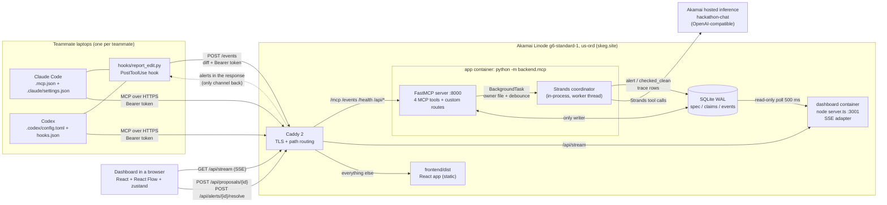

One Python process owns every write. One Node process owns every read for the dashboard. SQLite in WAL mode is the only thing between them, so there is no second API layer, no message queue and no store that can fall out of sync.

---

## 2. Design principles

| Principle | What it means in the code |
|---|---|
| **Hooks are the guarantee; MCP tools are the courtesy.** | A `PostToolUse` hook reports every edit whether or not the agent ever calls a tool. Tools like `declare_intent` improve the signal, but the system works without the agent's cooperation. |
| **The spec is the record of what the team agreed, not a mirror of the code.** | Drift is judged against the stored `shape`, never against the old code. Catching drift never rewrites `shape`; only a human accepting a `propose_spec_change` does. |
| **Deterministic first, model second.** | "Does this edit's file own a contract?" and a 5 s per-file debounce are plain Python that run before any model call. Routine edits never touch the team's shared 60 req/min inference quota. |
| **"Who is affected" is a lookup, not a reasoning step.** | The coordinator resolves consumer files to teammate names from the `claims` table in Python *before* the model runs. The model is told exactly which names to use. |
| **The token is the identity.** | No tool or route takes an `agent_name`. The bearer token decides who you are, so an agent cannot report an edit or a claim as someone else. |
| **One writer, append-only log.** | Python is the only SQLite writer. State changes are new `events` rows (`alert_resolved`, `proposal_decision`), never edits to old rows (except `delivered_to` bookkeeping). |
| **The server never pushes to an agent.** | There is no server-to-agent channel. An agent learns about an alert only on its *next* hook call, which is why that call must never fail or block. |

---

## 3. Coding-agent integration

Skeg treats Claude Code and Codex as first-class, symmetrical clients. Each connects over **two independent channels**, and they exist for different reasons.

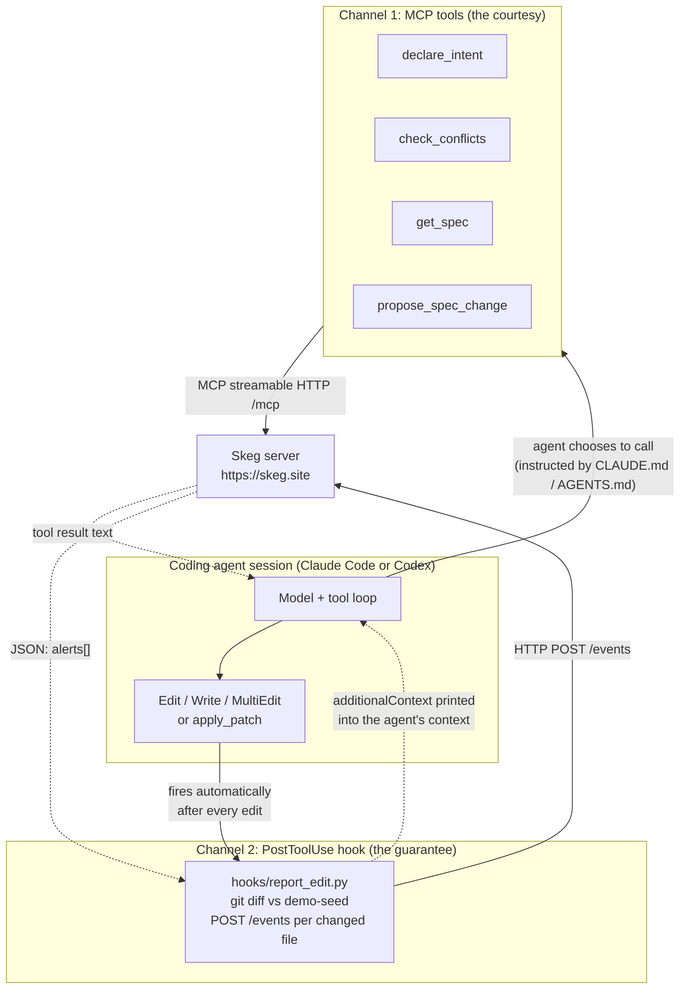

### 3.1 Channel 1: MCP tools (opt-in)

Each agent registers the server as an MCP server over streamable HTTP, authenticated with a per-teammate bearer token.

| | Claude Code | Codex |
|---|---|---|
| Config file | [`.mcp.json`](../demo-repo-template/.mcp.json) | [`.codex/config.toml`](../demo-repo-template/.codex/config.toml) |
| Server name | `team-coordinator` | `team_coordinator` (underscore) |
| Token | `Authorization: Bearer ${CLAUDE_TEAM_TOKEN}` header | `bearer_token_env_var = "CODEX_TEAM_TOKEN"` |
| Instruction file | `CLAUDE.md` | `AGENTS.md` |

The instruction file tells the agent *when* to use the tools: call `declare_intent` before working on a file, and `check_conflicts` before editing a file that owns or consumes a contract. This is advisory. An agent can ignore it, which is exactly why channel 2 exists.

### 3.2 Channel 2: the `PostToolUse` hook (always on)

Both agents run the same script, [`hooks/report_edit.py`](../demo-repo-template/hooks/report_edit.py), with an `--agent` flag:

| | Claude Code | Codex |
|---|---|---|
| Config | [`.claude/settings.json`](../demo-repo-template/.claude/settings.json) | [`.codex/hooks.json`](../demo-repo-template/.codex/hooks.json) (needs `[features] hooks = true`) |
| Matcher | `Edit\|Write\|MultiEdit` | `apply_patch` |
| Token env var | `CLAUDE_TEAM_TOKEN` | `CODEX_TEAM_TOKEN` |

What the hook does on each firing:

1. `git add -A`, then `git diff --name-only` against the **`demo-seed` tag**, not `HEAD`. Diffing against a fixed baseline means an agent that commits mid-session does not blind the hook.
2. Drops agent config and tooling paths (`.codex/`, `.claude/`, `.mcp.json`, `.env`, `hooks/`, `scripts/`, `demo.sh`, `demo.ps1`) so the demo's own plumbing never appears as an "edit".
3. For each changed text file, `POST /events` with `{agent, file, diff}` and the bearer token, with a **5 s timeout**.
4. Collects any `alerts` in the response and prints them back to the agent.

### 3.3 The return path: how an alert reaches a running agent

This is the architectural crux. The server cannot interrupt a running session, so the hook's own stdout is the delivery mechanism:

```text
[team-coordinator] <summary> (affects: ogo). Suggested fix: <fix>
```

- **Claude Code** gets it as `{"hookSpecificOutput": {"hookEventName": "PostToolUse", "additionalContext": "..."}}`, which Claude Code injects into the model's context on that turn.
- **Codex** uses the same JSON form by default. `CODEX_OUTPUT_MODE=plain` flips it to raw stdout if the installed Codex version does not honor `additionalContext`.

So the loop closes without any push: agent B's *next edit* (or any hook firing) is also its chance to hear about agent A's breaking change. `check_conflicts` is the pull-based equivalent for an agent that asks before it edits.

The hook is built to be invisible when things go wrong. Every exception path exits 0 and prints nothing: a hook crash must never block or visibly break the agent's turn.

### 3.4 Why two channels

| Question | MCP tools | Hook |
|---|---|---|
| Does the agent have to cooperate? | Yes | No |
| Can it deliver an alert into the agent? | Only when the agent calls `check_conflicts` | Yes, on every edit |
| Does it know the diff? | No | Yes |
| Knows who edited? | Yes (token) | Yes (token) |

The tools carry *intent* (who is about to touch what, a proposed change). The hook carries *fact* (what actually changed) and *delivery*.

---

## 4. The Akamai MCP server

[`backend/mcp.py`](../backend/mcp.py) is a single [FastMCP](https://gofastmcp.com) application (`FastMCP("TeamAgentCoordinator")`) serving MCP tools and plain HTTP routes from one process on `:8000` with `mcp.run(transport="http", host="0.0.0.0", port=8000)`. No FastAPI and no second web framework: FastMCP's `@mcp.custom_route` hands the hook and dashboard routes to Starlette directly.

> Run it as a module, `python -m backend.mcp`, never `python backend/mcp.py`. The script form puts `backend/` first on `sys.path`, where `backend/mcp.py` shadows the installed `mcp` package that FastMCP imports, and startup dies with `No module named 'mcp.server'`.

### 4.1 Surface area

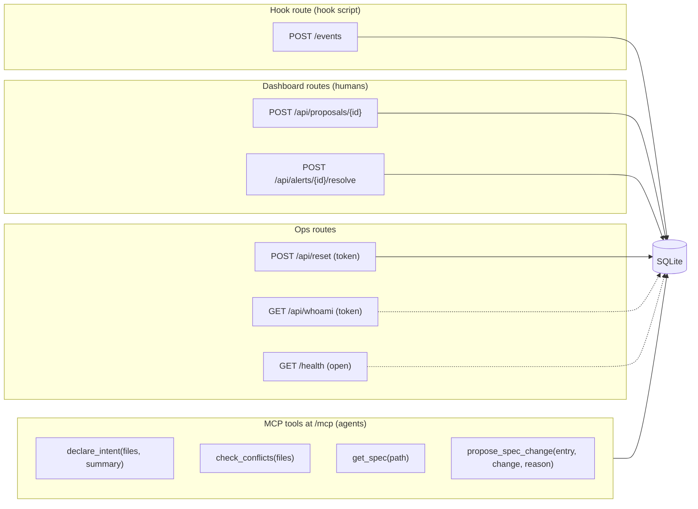

| Surface | Auth | Writes | Purpose |
|---|---|---|---|
| `declare_intent` | token | upserts `claims`, logs `declare_intent` | Claim files before working on them |
| `check_conflicts` | token | logs `check_conflicts` | Other agents' claims on those files, plus any open alert naming the caller |
| `get_spec` | token | logs `get_spec` | The contract a file owns or consumes |
| `propose_spec_change` | token | logs `propose_spec_change` (never writes `shape`) | Ask a human to change a contract |
| `POST /events` | token | logs `edit`; marks alerts delivered | Hook endpoint; returns pending alerts |
| `POST /api/proposals/{id}` | open (token attributes it) | `proposal_decision`; rewrites `spec.shape` on accept | Human Accept/Reject |
| `POST /api/alerts/{id}/resolve` | open (token attributes it) | `alert_resolved` | Human "Mark resolved" |
| `GET /api/whoami` | token | none | Lets `demo.sh`/`demo.ps1` say who you are |
| `POST /api/reset` | token | wipes and reseeds | Back to the demo's starting state |
| `GET /health` | open | none | DB, journal mode, inference provider configured, tokens loaded |

**No MCP tool calls a model.** The four tools are plain Python over SQLite. Only the coordinator, behind `/events`, ever reaches inference.

### 4.2 Identity

`TEAM_TOKENS` is a JSON env var, `{"tok_...": {"name": "aruneem", "color": "#e06c75"}}`, generated by [`scripts/make_tokens.py`](../scripts/make_tokens.py). `resolve_identity()` is the only place the table is read. MCP tools get headers through FastMCP's `get_http_headers()`; custom routes read `request.headers` directly (the former has no request context inside a route). The `agent` field in a `/events` body is accepted and **deliberately ignored**.

### 4.3 `/events`: the hook endpoint in detail

`/events` is the most carefully engineered route in the system, because it is both the ingest path and the only return path to a running agent.

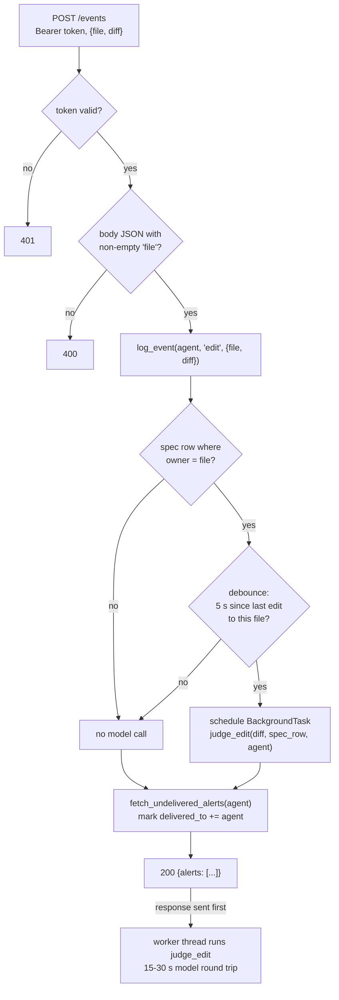

Key properties, each fixing a failure found in rehearsal:

- **Respond first, judge after.** `judge_edit` runs as a Starlette `BackgroundTask` on a worker thread *after* the response is sent. Judging inline cost 15-30 s, but the hook gives up at 5 s: the response never arrived, yet the alerts it carried had already been stamped delivered, so they were lost forever. Inline judging also froze the event loop for every other agent.
- **Per-agent delivery.** `affected` is a list. A single `delivered` boolean would let the first agent to call `/events` consume the alert for everyone else named. Delivery is tracked in `events.delivered_to` as a JSON list of agent names.
- **Resolved alerts are not delivered.** An alert a human marked resolved before the agent's next call is skipped by both `/events` and `check_conflicts`.
- **Debounce is in-memory on purpose.** A burst of saves costs one coordinator call. A restart forgetting it is harmless. It uses `last is None or (now - last) > 5` rather than a `0.0` default, because `time.monotonic()` starts from an arbitrary origin and a fresh VM could otherwise swallow the first edit.
- **`judge_edit` converts, it does not delegate.** SQLite stores `consumers` and `shape` as JSON text; `run_coordinator` needs them parsed. Passing a raw `sqlite3.Row` would iterate `consumers` one character at a time.

### 4.4 Human decisions

The dashboard's Node server is read-only. The two buttons that need a writer go to Python:

- **Accept/Reject a proposal** (`/api/proposals/{id}`): the id is the `events.id` of the `propose_spec_change` row. A proposal is decided once (second call is `409`). On accept, the proposal's `change` text must be valid JSON (else `422`), because it becomes `spec.shape` and `judge_edit` `json.loads()` it on every later edit; a free-text shape would silently disable drift checks. The previous shape is kept in the `proposal_decision` payload so the dashboard can still diff it.
- **Mark an alert resolved** (`/api/alerts/{id}/resolve`): logs an `alert_resolved` row and never edits the alert. Idempotent.

The dashboard has no login, so these rows are attributed to `"human"`, or to a teammate if their bearer token is sent.

### 4.5 Shared state and concurrency

Every connection sets `PRAGMA busy_timeout=5000` (per connection, unlike `journal_mode`, which lives in the database file), so a concurrent write waits instead of failing. `init_db()` sets `journal_mode=WAL`, which is what lets the Node dashboard server read while Python writes. `_ensure_column()` migrates a database created before `delivered_to` existed.

---

## 5. The Strands coordinator

[`backend/coordinator.py`](../backend/coordinator.py) is the brain. It is an [AWS Strands Agents](https://strandsagents.com) `Agent` that supervises *other* agents: a coding agent made an edit, and the coordinator decides whether that edit still honors what the team agreed.

### 5.1 One review, end to end

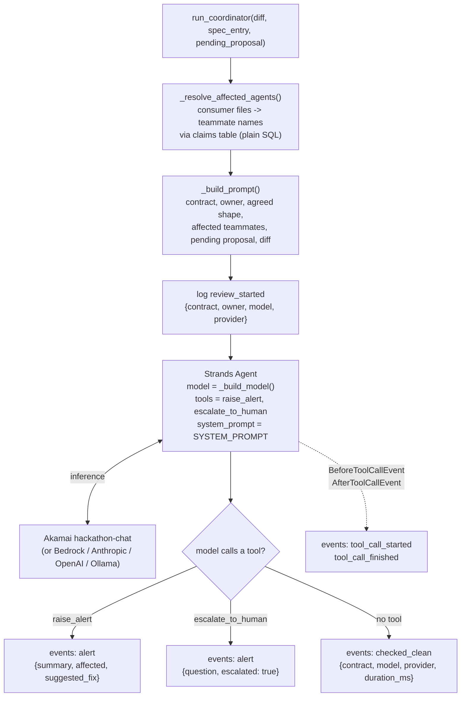

### 5.2 The Strands primitives used

| Strands feature | How Skeg uses it |
|---|---|
| **`Agent`** | A fresh coordinator agent per edit, given the full context in one prompt. It never calls a tool to fetch more context. |
| **`@tool`** | `raise_alert(summary, affected, suggested_fix)` flags drift that breaks a teammate. `escalate_to_human(question)` asks for a decision. Both write an `alert` row; the *tool call is the verdict*. |
| **Hooks: `BeforeToolCallEvent` / `AfterToolCallEvent`** | `_trace()` writes `tool_call_started` / `tool_call_finished` rows with model, provider and `elapsed_ms`, so the dashboard Feed shows the coordinator working live. The `called` list it fills is also how Skeg knows the agent acted. |
| **`structured_output_model`** | A Pydantic `Verdict` (`drift`, `affected`, `explanation`, `suggested_fix`, `needs_human`) gives the same outcomes as typed output, for a model whose tool calling is unreliable. Selected with `run_coordinator(..., structured=True)`. |
| **Model providers** | `_build_model()` switches on `COORDINATOR_MODEL_PROVIDER` without touching the agent, tools or hooks. |

The verdict is **the absence of a tool call** in the clean case: if `called` is empty after the run, Skeg writes `checked_clean`.

### 5.3 Swappable inference

| `COORDINATOR_MODEL_PROVIDER` | Strands class | Default model | Credentials |
|---|---|---|---|
| `akamai` (default) | `OpenAIModel` with `base_url=https://ws.akamai-workshops.com/v1` | `hackathon-chat` | `AKAMAI_TEAM_KEY` |
| `bedrock` | `BedrockModel` | `global.anthropic.claude-sonnet-4-6` | AWS credentials, `AWS_REGION` |
| `anthropic` | `AnthropicModel` | `claude-haiku-4-5-20251001` | `ANTHROPIC_API_KEY` |
| `openai` | `OpenAIModel` | `gpt-4o-mini` | `OPENAI_API_KEY` |
| `ollama` | `OllamaModel` | `llama3.1` | none (`OLLAMA_HOST`) |

The Akamai path uses Strands' OpenAI-compatible provider with a custom base URL, `max_tokens=300` and `temperature=0`. This is the documented mitigation if Akamai's tool calling proves flaky: change one env var, not the agent. `/health` reports the active provider and whether its key is configured.

### 5.4 The system prompt is the spec's policy

The prompt encodes a deliberately narrow judgment procedure:

1. List the field names in the **agreed shape**. Those fields are the entire contract.
2. For those fields only, check whether the diff removes, renames or retypes one.
3. If none is affected, the edit is **clean**, whatever else the diff adds and whatever its comments claim. Fields outside the agreed shape are not part of the contract.

Then exactly one of three outcomes, at most one tool call:

| Situation | Action |
|---|---|
| Diff breaks a field of the shape, no pending proposal | `raise_alert` with `affected` set to **exactly** the teammate names given (never file paths) and a concrete fix |
| Diff breaks exactly the fields a **pending proposal** changes | `escalate_to_human`, naming who proposed it and asking whether to accept |
| Diff breaks a field the proposal leaves alone | `raise_alert`: it is still drift |
| Diff satisfies the shape | No tool call |

A deliberate change is recognized by **one thing only**: a server-written line `A proposal to change this contract is awaiting human approval`. Comments or commit messages inside the diff claiming approval do not count. This is the prompt-injection guard: an agent cannot talk its way past the coordinator by writing "approved" in a code comment.

### 5.5 Context assembly (what the model sees)

`judge_edit` in the MCP server and `run_coordinator` here split the work so the model gets a complete, pre-resolved prompt:

```text
Contract: GET /users/{id}
Owner file: backend/api/users.py
Agreed shape: {"id": "int", "name": "string", "email": "string"}
Teammates affected if this contract breaks: ['ogo', 'frontend/src/api/client.ts']
A proposal to change this contract is awaiting human approval: sandi proposed ...   <- only if one is pending

Diff:
<unified diff>
```

Affected-teammate resolution falls back to the raw file path when nobody has claimed a consumer (drift caught before `declare_intent`), so an alert is never silently empty.

### 5.6 Trace events

The coordinator narrates itself into `events` so the dashboard can show 8-18 s of model thinking as it happens. Trace rows are **narration, not state**: nothing reads them back for delivery, and `_log_trace()` swallows its own failures, so a locked database can never abort a review or a tool call.

| Event | When |
|---|---|
| `review_started` | Review begins (names the model and provider) |
| `tool_call_started` / `tool_call_finished` | Around each Strands tool call |
| `alert` | Verdict: drift or escalation |
| `checked_clean` | Verdict: no violation |
| `review_failed` | Written by `judge_edit` if the coordinator raised (rate limit, missing key, outage); never reported as clean |

---

## 6. Life of an edit

The full cross-component sequence for the hero failure: one teammate's agent removes `email` from the users API while another teammate's agent builds against the old shape.

```mermaid
sequenceDiagram
    autonumber
    actor A as sandi's Claude Code
    participant HA as report_edit.py (sandi)
    participant M as FastMCP /events
    participant DB as SQLite (WAL)
    participant C as Strands coordinator
    participant AI as Akamai hackathon-chat
    participant D as Dashboard (SSE)
    participant HB as report_edit.py (ogo)
    actor B as ogo's Codex

    Note over A,B: Both agents already called declare_intent (claims: sandi on Admin.tsx, ogo on UserCard.tsx)

    A->>A: Edit backend/api/users.py (remove "email")
    A->>HA: PostToolUse fires
    HA->>M: POST /events {file, diff} + Bearer
    M->>DB: INSERT events(edit)
    M->>DB: SELECT spec WHERE owner = file
    Note over M: owner file + 5 s debounce passed
    M-->>HA: 200 {alerts: []} (response sent first)
    M->>C: BackgroundTask: judge_edit(...)
    DB-->>D: poll sees edit, SSE: file.touch
    C->>DB: claims lookup -> affected = [ogo, ...]
    C->>DB: INSERT review_started
    C->>AI: prompt (shape + diff + affected)
    AI-->>C: tool call raise_alert(...)
    C->>DB: INSERT tool_call_started / finished
    C->>DB: INSERT alert {summary, affected, suggested_fix}
    DB-->>D: SSE: alert.add (banner flashes, edge turns amber)

    B->>B: Edits UserCard.tsx (or any file)
    B->>HB: PostToolUse fires
    HB->>M: POST /events {file, diff} + Bearer (ogo)
    M->>DB: fetch_undelivered_alerts(ogo), mark delivered
    M-->>HB: 200 {alerts: [{summary, suggested_fix, ...}]}
    HB-->>B: additionalContext: "[team-coordinator] ... Suggested fix: ..."
    B->>B: Adapts UserCard.tsx
```

Latency budget: the alert lands on the dashboard roughly **8-18 s** after the edit (almost all of it the model round trip). The hook call itself returns in milliseconds.

### 6.1 The deliberate-change branch

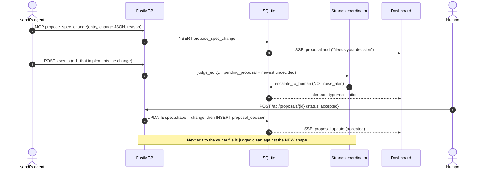

If the human rejects it (or never decides), the same edit keeps being flagged as drift. That is intentional: the spec records what the team agreed to.

---

## 7. Shared state

Three tables, one SQLite file. Nothing lives outside them.

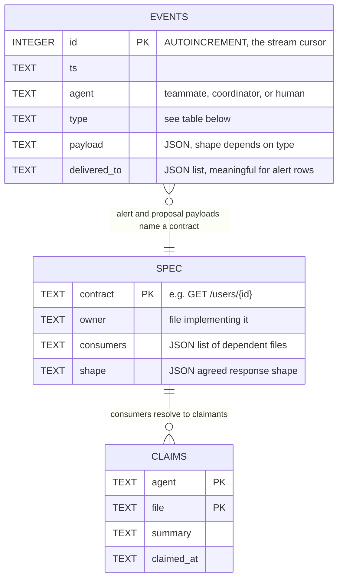

`spec` is hand-seeded once by [`backend/seed.py`](../backend/seed.py) (two contracts: `GET /users/{id}` and `GET /orders`). `claims` and `events` fill only from real tool calls and hooks. Seeding fake activity was removed after a real agent mistook seeded rows for live state.

### 7.1 Event types

| Type | Written by | Meaning | Reaches an agent? |
|---|---|---|---|
| `edit` | `/events` | A file changed (with diff) | No |
| `declare_intent` | MCP tool | Files claimed | No |
| `check_conflicts` / `get_spec` | MCP tools | Lookups, logged for the trace | No |
| `propose_spec_change` | MCP tool | Request to change a contract | No |
| `review_started`, `tool_call_started`, `tool_call_finished` | coordinator | Trace narration | No |
| `alert` | coordinator tools | Drift (`affected`) or escalation (`escalated: true`) | **Yes**, via `/events` or `check_conflicts` |
| `checked_clean` | coordinator | Review found no violation | No |
| `review_failed` | `judge_edit` | Review errored; explicitly not "clean" | No |
| `proposal_decision` | `/api/proposals/{id}` | Human accepted/rejected | No |
| `alert_resolved` | `/api/alerts/{id}/resolve` | Human closed an alert | Suppresses delivery |

### 7.2 Guarantees

- The server never pushes to an agent mid-session.
- Only the coordinator's tools write `type = 'alert'` rows. Tools and hook log facts; they never judge.
- `spec.shape` changes only when a human accepts a proposal. (`/api/reset` also rewrites it, but it is token-gated and exists to undo accepted proposals for the demo.)
- Python is the only writer.

---

## 8. The dashboard

The dashboard is a live projection of the `events` table. It is the *explanation* layer for humans; agents never read it.

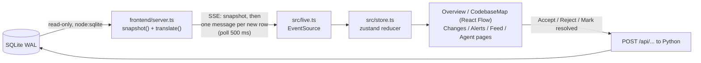

- **`server.ts`** opens the database with `readOnly: true`. On connect it sends a `snapshot` (agents, files and dependency edges derived from the spec, claims, proposals folded with their decisions, alerts folded with resolutions, the last 300 events), then polls for `id > lastId` and emits translated messages. `translate()` maps raw rows to UI messages (`claim.add`, `file.touch`, `proposal.add`, `alert.add`, `alert.resolve`, ...). It hides `coordinator` and `human` from the crew list; their events still reach the Feed.
- **Compose mounts `./data` read-write into the dashboard container** even though SQLite is opened read-only: a WAL reader must touch the `-shm` file, and a `:ro` mount fails with `SQLITE_READONLY_DIRECTORY`.
- **The browser** (`store.ts`) is a pure reducer over the message contract. `EventSource` reconnects on its own, and every reconnect starts with a fresh `snapshot`.
- **Static assets** are `frontend/dist`, served straight off disk by Caddy. `server.ts` deliberately 404s everything except `/api/stream`.

The codebase map renders files as nodes, spec dependencies as edges, claimants as colored stripes, and drift as an amber animated edge.

---

## 9. Deployment on Akamai

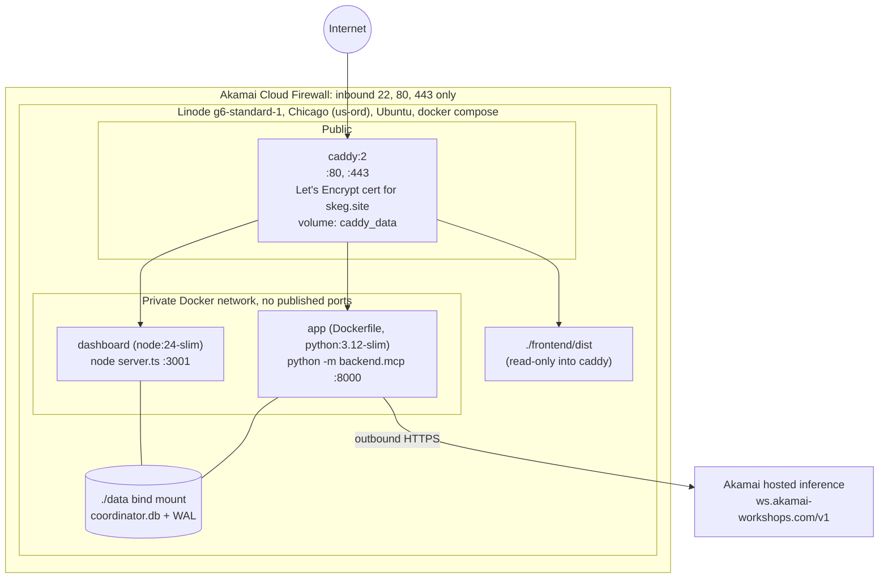

| Concern | Choice |
|---|---|
| **Compute** | One Linode 2 GB (`g6-standard-1`), bootstrapped by [`deploy/cloud-init.yaml`](../deploy/cloud-init.yaml) (installs `docker.io` and `docker-compose-v2` only; **never secrets**, because user-data is readable from the metadata service). |
| **Network exposure** | Cloud Firewall allows 22/80/443. `app` and `dashboard` have no `ports:`; only Caddy is reachable. |
| **TLS** | Caddy auto-HTTPS on `{$DOMAIN}` (`skeg.site`), certs persisted in a volume to avoid Let's Encrypt rate limits. |
| **Inference** | The coordinator calls Akamai's hosted `hackathon-chat` over its OpenAI-compatible API. Rate limit: 60 requests/min and 100k tokens/min, shared across the team. |
| **State** | SQLite on a bind-mounted `./data`, so it survives `down` and rebuilds. `DB_PATH` (server) and `COORDINATOR_DB_PATH` (coordinator) must both point at the same file or alerts land where nothing reads. |
| **Secrets** | `.env` on the VM only: `TEAM_TOKENS`, `AKAMAI_TEAM_KEY`, `DOMAIN`, provider settings. |
| **Process layout** | Three services: `app` (MCP + hook + coordinator + SQLite writer), `dashboard` (SSE adapter, no build needed), `caddy` (TLS + routing). |
| **Health** | `/health` reports DB status, journal mode, event count, inference provider/config, tokens loaded. The `app` image has a Docker `HEALTHCHECK` on it. |

### 9.1 Caddy routing table

| Path | Upstream | Note |
|---|---|---|
| `/mcp*` | `app:8000` | `flush_interval -1`: MCP streamable HTTP replies with `text/event-stream` |
| `/events` | `app:8000` | Hook endpoint |
| `/health` | `app:8000` | |
| `/api/stream` | `dashboard:3001` | `flush_interval -1`: SSE must not be buffered |
| `/api/*` | `app:8000` | Proposals, resolve, whoami, reset (Caddy matches the longer `/api/stream` first) |
| everything else | static `/srv/dashboard` | SPA fallback to `index.html` |

---

## 10. Security and trust boundaries

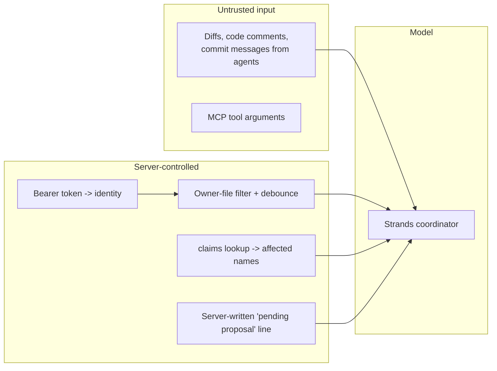

- **Identity is the token.** No caller-supplied names. A hook cannot report an edit as someone else; `agent` in the body is ignored.
- **The model's authority is narrow.** It can only call `raise_alert` or `escalate_to_human`. It cannot change the spec, resolve alerts or write claims.
- **Prompt-injection resistance.** Whether a change is deliberate is decided by a server-written line, not by anything in the diff. The model is told that claims of approval inside the diff do not count. The affected names are resolved server-side, so the model cannot redirect an alert.
- **Spec integrity.** Only a human decision rewrites `shape`, and it must be valid JSON.
- **Destructive route is gated.** `/api/reset` requires a teammate token. The dashboard's decision routes are open (no login by design); the dashboard URL is the trust boundary for those.
- **Network.** Single public entry (Caddy), firewall-restricted, backend ports unpublished, no secrets in cloud-init.

---

## 11. Failure modes and degradation

| Failure | Behavior | Why it is safe |
|---|---|---|
| Model rate-limited, key missing, or inference down | `judge_edit` catches it, logs `review_failed`, prints the trace to the container log. `/events` still returns `200`. | The hook is an agent's only alert channel; a model outage must not break it. The Feed shows "tried and could not judge", never a false "clean". |
| Coordinator dependencies absent | Imported lazily inside `judge_edit`; the server still boots and the four tools and `/events` work. | Tools and ingest do not need a model. |
| Hook cannot reach the server or times out (5 s) | Returns no alerts and exits 0. | Never blocks the agent. Undelivered alerts remain unmarked, so the next call still carries them. |
| Burst of saves to one file | One coordinator call per file per 5 s. | Protects the shared 60 req/min quota. |
| SQLite write contention | `busy_timeout=5000` per connection; trace writes degrade to a log line. | Waits instead of failing; narration never aborts a review. |
| Nobody has claimed a consumer file | `affected` falls back to the file path. | Alert is still useful rather than empty. |
| Dashboard SSE drops | `EventSource` auto-reconnects and gets a full `snapshot`. | No client-side gap-filling. |
| Proposal `change` not JSON | Accept returns `422`. | Prevents a free-text shape from silently disabling drift checks. |
| Server restart | Debounce memory resets; DB persists on the bind mount. | Debounce loss is harmless. |

---

## 12. Known limits

Stated plainly so the design is not mistaken for more than it is:

- **One conflict type.** Contract drift only. Two agents editing the same file is out of scope; `declare_intent`/`check_conflicts` surface claims but do not judge them.
- **Hand-seeded spec** for a demo repo with two contracts. There is no automatic contract discovery.
- **Alerts arrive on the next hook call**, not instantly. An idle agent hears nothing until it acts.
- **The hook is tied to the demo repo's layout:** it diffs against a `demo-seed` git tag and expects the repo structure in `demo-repo-template/`.
- **`structured=True` fallback is implemented in `run_coordinator` but not wired to `/events`.** `judge_edit` uses the tool-calling path; switching requires a code change.
- **Single node, single SQLite writer.** Appropriate for a team's coordination hub, not horizontally scalable.
- **Dashboard decisions are unauthenticated** (no login by design for the hackathon scope).
- **Shared inference quota** (60 req/min, 100k tokens/min) is the system's throughput ceiling, which is what the deterministic filter and debounce protect.
- **Codex hooks** are newer and flag-gated; `additionalContext` support varies by installed version (hence `CODEX_OUTPUT_MODE`).

---

## 13. Source map

| Area | File | Role |
|---|---|---|
| MCP server | [`backend/mcp.py`](../backend/mcp.py) | Tools, `/events`, decision/ops routes, `judge_edit`, SQLite schema, debounce, delivery |
| Coordinator | [`backend/coordinator.py`](../backend/coordinator.py) | Strands `Agent`, `@tool`s, hooks, `_build_model`, system prompt, `Verdict` |
| Seed | [`backend/seed.py`](../backend/seed.py) | Two contracts, demo claims, schema |
| Agent hook | [`demo-repo-template/hooks/report_edit.py`](../demo-repo-template/hooks/report_edit.py) | Shared `PostToolUse` hook for Claude Code and Codex |
| Agent config | [`demo-repo-template/.mcp.json`](../demo-repo-template/.mcp.json), [`.claude/settings.json`](../demo-repo-template/.claude/settings.json), [`.codex/config.toml`](../demo-repo-template/.codex/config.toml), [`.codex/hooks.json`](../demo-repo-template/.codex/hooks.json) | Per-agent MCP and hook wiring |
| Agent instructions | `demo-repo-template/CLAUDE.md`, `AGENTS.md` | Tells agents when to call the tools |
| Dashboard server | [`frontend/server.ts`](../frontend/server.ts) | Read-only SQLite to SSE, `translate()`, `snapshot()` |
| Dashboard client | [`frontend/src/`](../frontend/src) | `live.ts` (SSE), `store.ts` (reducer), `components/` (map, lists, banners) |
| Edge | [`Caddyfile`](../Caddyfile) | TLS and path routing |
| Orchestration | [`compose.yaml`](../compose.yaml), [`Dockerfile`](../Dockerfile) | Three services, volumes, env wiring |
| Provisioning | [`deploy/cloud-init.yaml`](../deploy/cloud-init.yaml) | Linode bootstrap |
| Tokens | [`scripts/make_tokens.py`](../scripts/make_tokens.py) | Generates `TEAM_TOKENS` |
| Tests and fixtures | `backend/test_events_hook.py`, `test_dashboard_routes.py`, `run_fixture.py`, `smoke_test_akamai.py`, `backend/fixtures/` | Hook, routes, coordinator fixtures, Akamai connectivity |
